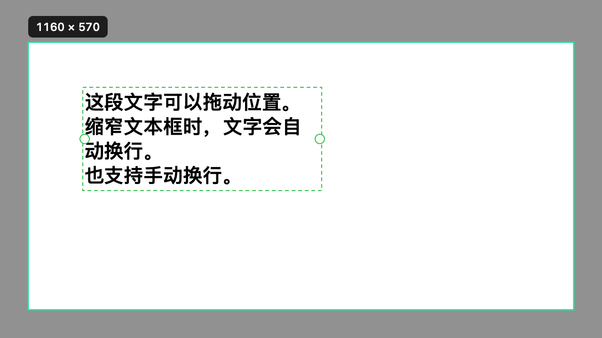

<p align="center"></p>

# 轻截 Qingjie

轻量的 macOS 菜单栏截图工具。按 **Control + S** 框选屏幕，直接标注、复制或保存。

使用 Swift、AppKit 和 ScreenCaptureKit 实现，截图与标注在本机处理，无需账号，不上传截图。项目以 MIT 协议开源。

## 功能

- 菜单栏常驻，可在菜单中开启登录自启动。
- 框选截图，支持 Retina 像素比例与多显示器。
- 矩形、椭圆、箭头、画笔、文字、马赛克六种标注。
- 文字可拖动位置，拖动文本框两侧手柄调整宽度并自动换行，双击再次编辑。
- 马赛克精细度可调，实时影响当前截图中的所有马赛克，并记住偏好。
- 撤销、重做、复制到剪贴板、保存 PNG。
- 白色单排工具条；当前不提供文字识别、翻译或长截图。



上图来自合成测试画面，不包含真实桌面内容。

## 快捷操作

| 操作 | 快捷键 / 手势 |
| --- | --- |
| 开始截图 | Control + S（菜单中可切换到 Command + Shift + A） |
| 撤销 | Command + Z 或 Control + Z |
| 重做 | Command + Shift + Z |
| 取消截图 | Esc |
| 完成并复制 | 非文字编辑状态下按 Return，或点击绿色勾 |
| 编辑文字时换行 | Return |
| 完成文字编辑 | Command + Return |
| 移动文字 / 调整自动换行 | 选择文字工具，拖动已有文字 / 左右手柄 |

全局快捷键会占用相应组合；若与其他软件冲突，可在轻截菜单中切换。

## 从源码构建

需要 macOS 14 或更新版本、可用的 Xcode / Command Line Tools、Python 3。当前已在 Apple Silicon 上验证；脚本也接受 `ARCH=x86_64`，Intel 构建尚未实机验证。

```sh
git clone https://github.com/thunderwong46/qingjie.git
cd qingjie

# 仅新开发环境首次运行，已有签名身份时会保留它。
python3 setup-signing.py
chmod +x build.sh
./build.sh

# 使用合成图片测试渲染、文字编辑与撤销，不需要读取真实屏幕。
build/轻截.app/Contents/MacOS/LightShot --self-test
```

产物为 `build/轻截.app`。构建不会自动安装、修改登录项或启动截图。

首次使用，把应用复制到 `/Applications/轻截.app` 后打开，在系统设置中允许屏幕录制；如系统提示，退出并重新打开应用。自启动通过应用菜单控制。

### 更新与屏幕权限

先退出轻截，再用构建好的应用替换 `/Applications/轻截.app`，最后从该位置重新打开。更新时保留相同 bundle ID、签名身份和安装位置，不需要删除应用偏好或重复添加登录项。

`setup-signing.py` 在本机生成专用签名身份，存放于 `~/Library/Application Support/LightShotSigning/`，不会把私钥或密码写进项目。`sign.py` 复用该身份并将代码签名要求绑定到证书，避免每次构建更换临时签名。常规构建在身份缺失时会停止，不会静默生成新身份。

本机自签名用于个人源码构建，不等同于 Apple Developer ID 签名或公证。不同开发者的证书不同，跨签名者替换应用可能需要重新授权；系统升级或系统策略也可能要求重新确认权限。已有安装不要删除或重新生成其签名身份。

可通过 `LIGHTSHOT_SIGNING_CONFIG` 指向已有签名 JSON；其中包含 `identity`（证书 SHA-1 指纹）、`keychain` 和 `passwordFile`（本机路径）。此配置及其引用文件不得上传。

## 源码结构

| 文件 | 内容 |
| --- | --- |
| `Main.swift` | 菜单栏、全局快捷键、屏幕捕获、登录自启动 |
| `Editor.swift` | 选区、标注、工具条、渲染、撤销与重做 |
| `TextEditing.swift` | 文本编辑、移动和宽度调整 |
| `SelfTest.swift` | 合成图像和交互状态回归测试 |
| `MakeIcon.swift` | 原生绘制绿色应用图标 |
| `Info.plist` | 应用元数据 |
| `build.sh` | 编译、生成图标和签名 |
| `setup-signing.py` / `sign.py` | 首次创建与后续复用本机签名身份 |

欢迎通过 Issue 报告问题，或提交 Pull Request。报告问题时请提供 macOS 版本、芯片类型与复现步骤；附图前请移除个人信息。修改截图渲染和文字交互后请运行自测。

## 许可证

[MIT](LICENSE)。本项目为独立实现，与微信及其他同名或相似名称的产品无关联。
